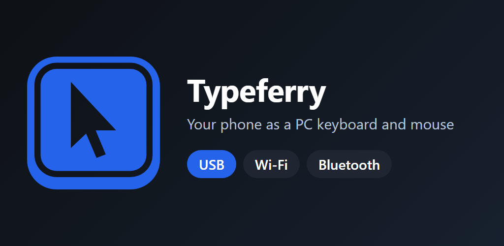

# Typeferry receiver

<!-- no-gif: a small Windows tray program with no demo recording of its own; the Typeferry phone app screens are the demo -->



*The Windows program that turns key presses from the Typeferry phone app into real key presses on your PC.*

The Typeferry Android app makes your phone a keyboard, a mouse and a set of shortcut keys. Bluetooth works with no PC program at all. Over USB or Wi-Fi the PC needs this receiver, because Windows cannot accept key presses from a phone over a network without a program that calls `SendInput`.

## Get it

1. Download `TypeferryReceiver.exe` from the [latest release](https://github.com/Exalt24/typeferry-receiver/releases/latest).
2. Check the download against the fingerprint the app's setup guide shows. In PowerShell: `(Get-FileHash .\TypeferryReceiver.exe).Hash`
3. Run it. It copies itself to `%LOCALAPPDATA%\Typeferry`, starts with Windows, and opens a pairing window until a phone has connected once.

The program is not code signed yet. Windows SmartScreen shows "unrecognized app" (More info, Run anyway), and Windows Smart App Control blocks it outright on PCs where that is on. On those PCs use the app's Bluetooth route, which needs no program.

## Pair a phone

The PC window shows a six digit number. Type it on the phone. A right number makes the phone show a second six digit number, which you type in the PC window. Both sides then derive the same 16 character code (Diffie-Hellman over RFC 3526 group 14, the PC commits first), and the ordinary link uses it. A wrong number pairs nothing.

## How it links

The phone listens on port 8777 and this program connects out to it, so Windows Firewall never prompts. It tries `adb forward` over USB first, then a USB tethering network, then Wi-Fi or a hotspot. Both sides prove they know the pairing code with fresh nonces before anything is sent, and every 8 byte frame is sealed to 16 bytes (encrypted, tag checked, counter bound). A dead link is caught by a heartbeat, and every key is released if the phone goes quiet for 5 seconds.

## Run from source

```powershell
python pc\phone_kb_receiver.pyw
```

The source is `pc/phone_kb_receiver.pyw` plus `pc/linkcrypto.py`, which uses only the Python standard library. `--pair` opens the pairing window and `--uninstall` removes the start with Windows entry.

## Limits

- It types into normal windows only: not elevated (administrator) windows, not UAC prompts, and nothing before you sign in.
- One phone and one PC: the receiver holds one phone's code, so pairing a second PC with the same phone replaces the first.
- An old receiver and a new app (or the other way round) cannot pair, so update both together.

## Privacy

The Typeferry app and this program collect nothing and send nothing to anyone but your own PC. The full text is the [privacy policy](https://exalt24.github.io/typeferry-receiver/privacy.html).

## Tips

Typeferry is free. If it helps you, you can send a tip with [Wise](https://wise.com/pay/me/danielalexisc6) (you need a Wise account).

## License

MIT, see [LICENSE](LICENSE).
